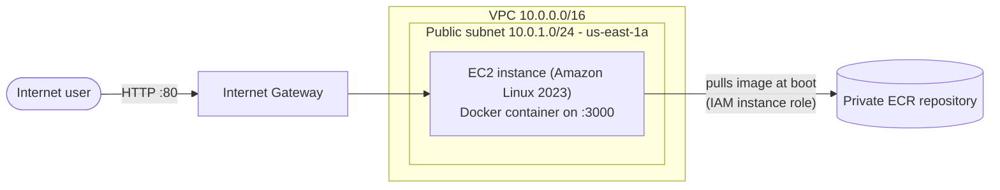

# TerraForge

TerraForge provisions a containerized Node.js application on AWS using Terraform. A private ECR repository holds the image, and a single EC2 instance pulls and runs it at boot, authenticating through an IAM role instead of stored credentials.

It is a deliberately small, single-instance foundation. The networking, IAM, registry and instance are all defined as code, and the project is being extended in phases (see [Roadmap](#roadmap)).

## Architecture



Request flow: Internet -> Internet Gateway -> public subnet -> EC2 (port 80) -> Docker (port 3000) -> Node.js app.

## What gets provisioned

| File | Resources |
|------|-----------|
| `terraform/vpc.tf` | VPC (`10.0.0.0/16`), public subnet (`10.0.1.0/24`), Internet Gateway, public route table with a default route and subnet association, security group (inbound HTTP 80 only, all outbound) |
| `terraform/ecr.tf` | Private ECR repository (scan on push) and a lifecycle policy that keeps the last 10 images |
| `terraform/iam.tf` | EC2 role and instance profile with `AmazonEC2ContainerRegistryReadOnly` (pull images) and `AmazonSSMManagedInstanceCore` (Session Manager access) |
| `terraform/ec2.tf` | Amazon Linux 2023 AMI lookup and the EC2 instance (IMDSv2 required, encrypted root volume) with a `user_data` bootstrap script |
| `terraform/variables.tf` | Region, image tag, instance type and ECR repository name |
| `terraform/outputs.tf` | Application URL, ECR repository URL and instance ID |
| `terraform/provider.tf` | Terraform and AWS provider version constraints |

On first boot the instance installs Docker, logs in to ECR using its IAM role, pulls the image, and runs the container with `--restart unless-stopped`, publishing host port 80 to container port 3000.

## The application

A small Express app with two endpoints:

| Endpoint | Response |
|----------|----------|
| `GET /` | JSON with a status message, the container hostname, process uptime and a timestamp |
| `GET /health` | `200 OK` (used by the Docker `HEALTHCHECK`) |

Example response from `/`:

```json
{
  "message": "TerraForge application is running",
  "hostname": "3f2a9c1b7d4e",
  "uptime": 123.45,
  "timestamp": "2026-10-25T07:30:00.000Z"
}
```

The `hostname` is the container ID, which makes it easy to tell instances apart once the app runs behind a load balancer.

### Container image

The Dockerfile (`app/Dockerfile`) is built with these choices:

- **Node 24 on Alpine**, a currently supported LTS base image.
- **Two stages**: production dependencies are installed with `npm ci --omit=dev` (reproducible, no dev packages), then copied into a fresh runtime image.
- **`.dockerignore`** keeps `node_modules`, `.env` and `.git` out of the build context.
- **Runs as the non-root `node` user.**
- **`HEALTHCHECK`** polls `/health` so `docker ps` reports `healthy` or `unhealthy`.
- **Exec-form `CMD ["node", "server.js"]`** makes Node PID 1, so `docker stop` delivers SIGTERM to the app directly instead of waiting for a forced kill.

## Prerequisites

- An AWS account and the AWS CLI configured for it (`aws sts get-caller-identity` should show the account you intend to use)
- Terraform 1.5 or newer
- Docker

The default instance type, `t3.micro`, is free-tier eligible on both older and newer AWS accounts.

## Deployment

The EC2 instance pulls the image at first boot, so the ECR repository needs an image in it before the instance is created. That means applying in two steps.

**1. Initialize and create only the ECR repository**

```bash
cd terraform
terraform init
terraform apply -target=aws_ecr_repository.app
```

**2. Build and push the image**

```bash
REPO=$(aws ecr describe-repositories --repository-names terraforge-app \
  --region us-east-1 --query 'repositories[0].repositoryUri' --output text)

aws ecr get-login-password --region us-east-1 | \
  docker login --username AWS --password-stdin "${REPO%%/*}"

docker build -t "$REPO:v1" ../app
docker push "$REPO:v1"
```

The repository name, region and tag above match the variable defaults. If you change them, change the commands to match. Use `sudo` with the Docker commands if your user is not in the `docker` group.

**3. Create the rest of the infrastructure**

```bash
terraform plan
terraform apply
```

**4. Test the deployment**

Give the instance two to three minutes to boot, install Docker and pull the image, then:

```bash
curl "$(terraform output -raw app_url)"
curl "$(terraform output -raw app_url)/health"
```

**5. Tear everything down when you are done**

```bash
terraform destroy
```

The ECR repository is created with `force_delete = true`, so destroy works even when it still contains images.

## Configuration

Override defaults with `-var`, or with a `terraform.tfvars` file (excluded from git):

| Variable | Default | Description |
|----------|---------|-------------|
| `region` | `us-east-1` | AWS region for the provider and ECR login |
| `image_tag` | `v1` | Image tag the instance pulls at boot |
| `instance_type` | `t3.micro` | EC2 instance type |
| `ecr_repo_name` | `terraforge-app` | Name of the ECR repository |

| Output | Description |
|--------|-------------|
| `app_url` | `http://` address of the instance |
| `ecr_repository_url` | Repository URL to push images to |
| `instance_id` | Instance ID (used for Session Manager and later for deployments) |

## Troubleshooting

**`curl` fails immediately with "Couldn't connect" on port 80.**
A refusal that comes back in milliseconds means the network path is fine and nothing is listening: the container is not running. The usual cause is that the image tag in `image_tag` does not exist in ECR, so the boot script's `docker pull` failed. Connect with **EC2 -> Connect -> Session Manager** and check:

```bash
sudo tail -50 /var/log/cloud-init-output.log
sudo docker ps -a
```

`user_data` runs only once, at first boot, so after pushing the missing tag, recreate the instance:

```bash
terraform apply -replace=aws_instance.app_server
```

**`terraform output` prints nothing.**
Outputs are written to state during an `apply`. If you added `outputs.tf` after the last apply, run `terraform apply` again (it makes no resource changes).

**`docker login` fails with "malformed HTTP Authorization header".**
The registry address was empty, so Docker tried to log in to Docker Hub with the ECR password. Run `echo "$REPO"` and make sure it prints a real repository URL before logging in.

## Security notes

- No AWS credentials in code or on the instance. The instance authenticates to ECR through an IAM role with a managed, read-only registry policy.
- Port 22 is closed. Shell access goes through SSM Session Manager.
- Only port 80 is open inbound.
- IMDSv2 is required on the instance and the root volume is encrypted.
- Images are scanned on push, and old images are expired by a lifecycle policy.
- State files are excluded from git, while `.terraform.lock.hcl` is committed to pin provider versions.

Known limitations: the app is served over plain HTTP, runs on a single instance in a single Availability Zone, and the subnet's AZ is hardcoded to `us-east-1a`, so changing `region` also requires updating `vpc.tf`.

## Project structure

```
.
├── app/
│   ├── Dockerfile
│   ├── .dockerignore
│   ├── package.json
│   └── server.js
├── terraform/
│   ├── .terraform.lock.hcl
│   ├── ec2.tf
│   ├── ecr.tf
│   ├── iam.tf
│   ├── outputs.tf
│   ├── provider.tf
│   ├── variables.tf
│   └── vpc.tf
└── README.md
```

## Roadmap

**Phase 2: CI/CD with GitHub Actions** (in progress)
- CI on pull requests: build the image, run a `/health` smoke test, scan with Trivy, run `terraform fmt -check` and `terraform validate`
- CD on merge to `main`: push to ECR tagged with the git commit SHA, deploy to the instance through SSM Run Command, and fail the job if `/health` does not pass
- Authenticate to AWS from GitHub with OIDC, with no long-lived access keys
- Switch ECR tags to immutable once images are tagged by SHA

**Phase 3: networking and resilience**
- Private subnet with a NAT Gateway for the application tier
- Application Load Balancer across two Availability Zones with HTTPS through ACM and a Route 53 domain
- Auto Scaling Group, with the instance security group restricted to the load balancer
- AWS WAF in front of the load balancer
- Remote Terraform state in S3 with locking
- CloudWatch dashboards and alarms

## Author

Vikrant Rathod

- GitHub: [Vikrant4549](https://github.com/Vikrant4549)
- LinkedIn: [vikrant24](https://www.linkedin.com/in/vikrant24)
